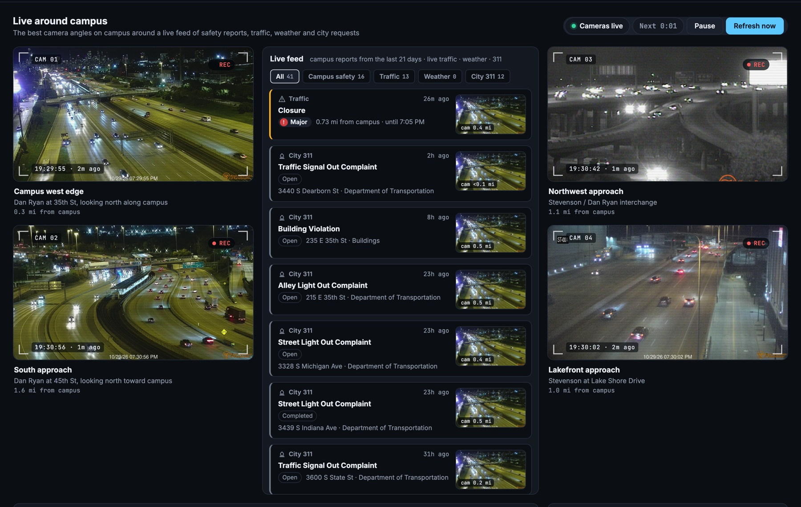

# IIT Public Surveillance

An interactive intelligence dashboard built on **every Illinois Tech Department of
Public Safety report for the Mies Campus since 2014**: about 5,000 incidents parsed
from 3,000+ daily log posts, placed on a campus map, and explorable through linked
charts. Traffic cameras, Chicago Police data, live traffic and weather alerts sit
alongside as add-ons.


## What you can do

- **Filter by anything.** Every chart is a filter, and every other view updates
  instantly: a date range, an incident family, a type, a building, an outcome, an
  hour, or a weekday. Each view ignores its own filter so you can still see the
  alternatives. The whole state lives in the URL, so any view can be shared.
- **Search 12 years of officer notes** from the top bar (`/`), with matches
  highlighted.
- **Brush the timeline.** The bottom strip shows the whole archive; drag across it
  to pick dates. The chart above shows those dates stacked by family, binned by
  day, week or month to fit. Click a column to zoom in.
- **Campus map.** Each place is sized by its report count, and incidents from the
  last 7 days pulse. **Replay** animates the chosen dates, with each report
  appearing on its building in its family color.
- **Case files.** Open any report (or step through with `j`/`k`) to see the full
  record, how precisely it was placed, a mini-map, the location's history since
  2014, and a link to the original log post.
- **Patterns:**
  - a 24-hour radial clock with a "now" hand
  - a day × hour punchcard
  - a calendar heatmap of every day on record
  - an alluvial flow from incident family to outcome
  - top locations with 12-year sparklines and year-over-year trends
- **KPIs:** this week vs. a typical week (meter), the last 30 days and year to
  date vs. last year, the most common family lately, and days since the last
  incident of whatever you've filtered to.
- **Jump to anything** with the `⌘K` / `Ctrl+K` command palette: a building, an
  incident type, a family, an outcome, a year, a camera, or an action like Replay
  or Export.
- **Export** the current view as CSV.

### Live around campus (add-ons)



- **Camera widgets.** The four best IDOT angles on and around campus are styled as
  monitor feeds (corner brackets, scanlines, a REC badge and capture time). They
  frame a **live feed** that merges recent campus reports, live traffic
  incidents, weather warnings and city 311 requests.
- **Nearest camera.** Every feed item with a location shows the frame from the
  traffic camera nearest to it. Campus reports open their case file.
- **Ticker.** The latest items scroll along the bottom of the screen like a news
  crawl. A severe weather warning also takes over the top banner.
- **On campus vs. the blocks around it.** Public Safety reports compared with
  Chicago Police reports within ½ mile over the same dates, plus crash patterns.
- **Dispatch & contacts.** IIT Public Safety numbers, IIT Alert sign-up, and why
  there is no public live dispatch feed (police radio has been encrypted since
  2024).

## Run it

Needs only **Python 3.9 or newer**. There's nothing to install and no build step.

```bash
git clone https://github.com/Dipzinski/iit-public-surveillance.git
cd iit-public-surveillance
python3 server.py
```

Open http://localhost:8000. On the first run the server downloads the whole Public
Safety log in the background (31 requests, about a minute) while the page shows
progress. After that it checks for new posts every 15 minutes.

```bash
python3 -m unittest discover -s tests -t .   # 27 tests
python3 -m safety.sync --rebuild             # re-parse the stored posts after changing the parser
PORT=9000 python3 server.py                  # another port
```

## How it works

```
IIT Public Safety blog ──► safety/sync.py ──► SQLite archive ──► safety/parser.py ──► safety/geocode.py
 (WordPress JSON API)       backfill, then      raw HTML kept      every log format      street model + learned
                            every 15 min        for re-parsing     since 2014            building addresses
                                                                                              │
                     browser ◄── /api/safety/dataset (all reports, columnar, 189 KB gzipped) ◄─┘
       crossfilter state · D3 charts · Leaflet maps · virtual-scrolling feed
```

**Parsing a decade of formats.** Since 2019 the log uses labeled fields
(`Incident Type / Location / Date/Time Reported / Notes / Disposition`). In
2014–2018 the location and time share one unlabeled line, inside markup pasted
from other apps. The parser works on text lines rather than tags, so it reads
every era. It also recognizes "no incidents" days (512 of them) and the safety
tips from 2011–2013, and older posts that run the type and location together on
one line. Real posts from each era are test fixtures.

**Geocoding without a geocoding service.**
`tools/calibrate_streets.py` fits where every street near campus runs from 53,000
geotagged Chicago Police block records. Given that, `safety/geocode.py` places:
- addresses ("3101 S Wabash")
- intersections ("33rd & Dearborn")
- block ranges ("Federal : 3200–3300 South")
- corners mentioned in notes ("robbed at 31st & State")
- building names, using addresses it learns from the log itself whenever a
  building appears with one (plus a small alias file for truncated or old names)

78% of reports are placed at an address, building, corner or block, and every
report records how precisely it was placed.

**A fast browser.** The server sends every report once as parallel arrays with
lookup tables, gzipped and ETag-cached. The page then does all filtering itself:
- Each view asks the shared state for the reports matching every filter but its
  own, cached per filter version.
- Chicago local time is computed with the DST rule directly, so 5,000 rows don't
  each need an `Intl` call.
- The feed keeps only the rows on screen in the DOM.

**Stack.** Python standard library (`http.server`, `sqlite3`, `urllib`) on the
backend. On the frontend, buildless ES modules with D3 7 and Leaflet. Chart
colors come from a palette checked for color-blind safety, with family colors in
a fixed order.

## Project layout

```
server.py              HTTP routes, camera relay, sync thread
safety/                Public Safety archive: sync, store, parser, geocode, taxonomy, dataset
feeds.py               neighborhood add-ons: crime, traffic, alerts, 311
common.py              shared helpers
tools/                 street-model calibration
data/site.json         campus location, outline, default cameras, contacts
data/geo/              streets.json (calibrated), aliases.json (building names)
static/js/safety/      main stage: state, timeline, map, feed, drawer, analytics
static/js/live/        camera widgets, live feed + ticker, context cards
static/js/palette.js   ⌘K command palette
tests/                 parser, geocoder and API tests with real fixtures
```

## Data sources

| Data | Source |
| --- | --- |
| Campus safety log | [Illinois Tech Department of Public Safety](https://blogs.iit.edu/public_safety/) (public WordPress API) |
| Street model | [Chicago Police crime reports](https://data.cityofchicago.org/Public-Safety/Crimes-2001-to-Present/ijzp-q8t2) (block-level locations) |
| Cameras, live incidents | [Illinois DOT](https://www.gettingaroundillinois.com/) public ArcGIS layers |
| Crime, crashes, 311 | [City of Chicago Data Portal](https://data.cityofchicago.org/) |
| Weather alerts | [National Weather Service API](https://www.weather.gov/documentation/services-web-api) |
| Basemap | Esri World Dark Gray Canvas, © OpenStreetMap contributors |

---

Student project built only from public data. Not affiliated with or endorsed by
Illinois Institute of Technology.
