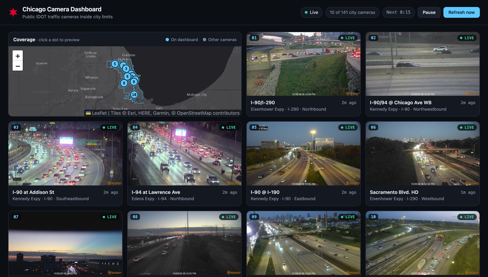

# Chicago Camera Dashboard

A web dashboard for the public traffic cameras inside Chicago city limits.
It shows 10 camera feeds that update on their own, plus a map of every
camera in the city. You can preview any camera and swap it onto your
dashboard.



## Features

- **Grid of 10 cameras** spread across the city: downtown, the Kennedy, the
  Edens, O'Hare, the Eisenhower, Lake Shore Drive, the Stevenson, and the
  Dan Ryan.
- **Automatic refresh.** Each tile checks for a new frame every 30 seconds and
  shows how old its frame is: **Live** (10 min or less), **Delayed** (up to
  30 min), **Stale**, or **Offline**.
- **Full-screen viewer.** Click a tile to enlarge it, and use ← → to move
  between cameras.
- **Coverage map.** The 10 dashboard cameras are numbered pins and the other
  city cameras are gray dots. Click a dot to preview that camera, then
  **Swap in** to put it on your dashboard. Your picks are saved in the browser.
- **Saves bandwidth.** Refreshing pauses while the tab is in the background,
  and there's a manual **Pause** button.
- **Responsive layout** from phone to wide desktop.

## Run it locally

Needs only **Python 3.8 or newer**. There's nothing to install and no build step.

```bash
git clone https://github.com/Dipzinski/chicago-camera-dashboard.git
cd chicago-camera-dashboard
python3 server.py
```

Then open http://localhost:8000. To use a different port, run `PORT=9000 python3 server.py`.

## How it works

```
Browser (static/)  ──►  server.py  ──►  IDOT camera feed (ArcGIS REST)
  index.html            /api/cameras      camera list + metadata
  styles.css            /api/snapshot/id  latest JPEG for one camera
  app.js                /api/boundary     Chicago city limits (GeoJSON)
```

**Backend (`server.py`).** Uses only the Python standard library
(`http.server`, `urllib`, `json`).
- Pulls the IDOT camera list and keeps only the cameras inside the official
  city boundary, using a point-in-polygon test. That leaves about 140 cameras.
- Caches the camera list for 60 seconds. If IDOT stops responding, it keeps
  serving the last good list.
- Fetches each camera's image itself. IDOT's image server rejects requests
  that carry another site's `Referer`. The server also passes along when each
  frame was captured, in an `X-Captured-At` header.
- Relays images only for camera IDs that are in the feed, so it can't be used
  as an open proxy.

**Frontend (`static/`).** Plain HTML, CSS, and JavaScript, with no framework.
- Each new frame is decoded off-screen before it's shown, so images swap
  without flicker.
- If you swap a tile to a different camera while a frame is still loading,
  the late frame is thrown away instead of appearing on the wrong tile.
- The map uses [Leaflet](https://leafletjs.com/) with Esri's free dark
  basemap, so it needs no API key.

## Data sources

| Data | Source |
| --- | --- |
| Traffic cameras | [Illinois DOT public traffic camera feed](https://services2.arcgis.com/aIrBD8yn1TDTEXoz/ArcGIS/rest/services/TrafficCamerasTM_Public/FeatureServer/0), the same data behind [Getting Around Illinois](https://www.gettingaroundillinois.com/) and [Travel Midwest](https://www.travelmidwest.com/) |
| City limits | [City of Chicago Data Portal: Boundaries - City](https://data.cityofchicago.org/resource/qqq8-j68g.geojson), simplified into `data/chicago_boundary.json` |
| Basemap | Esri World Dark Gray Canvas and © OpenStreetMap contributors |

The camera feeds are still images that IDOT re-captures about every 3
minutes. They are not video streams.

## Roadmap

- [ ] Add more public camera sources, such as the Illinois Tollway and
      city-run cameras where they're published
- [ ] Add a browse/search panel and bigger grids (16, 25, …) for an
      "all cameras" view
- [ ] Filter by expressway or neighborhood
- [ ] Make the map larger and spread out overlapping pins
